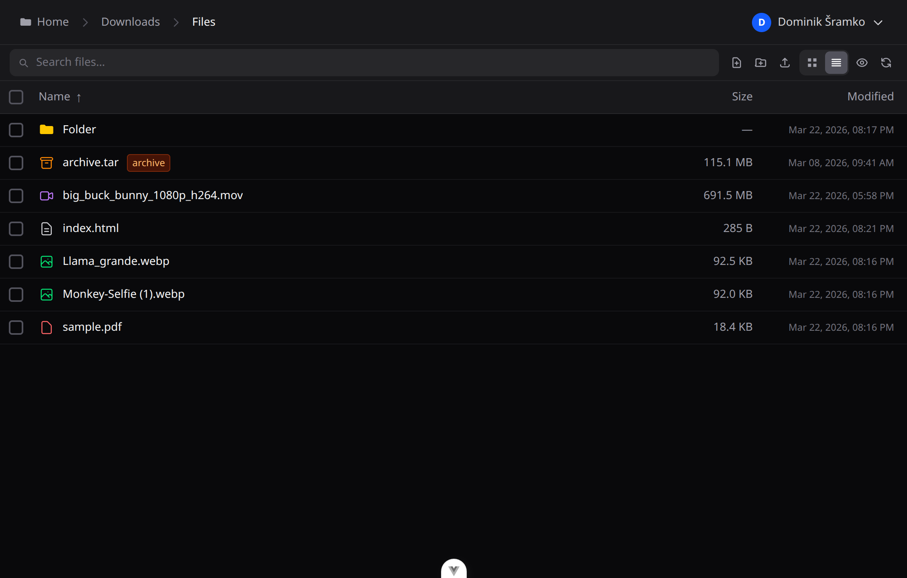

# Files &nbsp;`v1.0.0`

A self-hosted file browser with a Vue 3 frontend and Go backend. Browse, preview, and manage your files from any browser.

> This project was built entirely through pair programming with [Claude Code](https://claude.com/claude-code), Anthropic's AI coding assistant — as an experiment in how far you can take a real-world app that way.

## Screenshots



More screenshots in the [`screenshots/`](screenshots/) folder.

## Features

### File Browser
- Navigate directories, sort by name/size/date
- Multi-select with checkbox or keyboard shortcuts
- Create folders and new text files
- Rename, move, copy, delete — single or batch
- Upload files with drag-and-drop or file picker
- Download files or bulk-download as ZIP
- Real-time file system watching (directory updates without refresh)
- Search within the current directory

### Previews
- **Images** — JPEG, PNG, GIF, WebP, BMP, TIFF, SVG, plus AVIF, HEIC, HEIF, JXL, ICO, PSD, TGA, XCF, HDR, EXR, DDS (converted server-side via ImageMagick)
- **Video** — MP4, M4V, WebM, plus MKV, AVI, MOV, OGV, M2TS, MTS, WMV, ASF, FLV, MPG, MPEG, VOB, 3GP (played via adaptive HLS transcoding) — with subtitle track selection, and screenshot capture at the current timestamp
- **Subtitles** — SRT, VTT, ASS, SSA files next to the video, plus embedded subtitle tracks
- **Audio** — MP3, OGG, OGA, Opus, WebA, WAV, FLAC, AAC, M4A, plus WMA, AIFF, APE, WavPack, MKA, AC3, AMR, CAF (transcoded server-side to AAC)
- **PDF** — inline viewer with fallback for mobile
- **Text / Code** — plain text, Markdown, JSON, XML, HTML, CSS, JS, and more
- **Todo lists** — `.todo` files open in a checklist editor
- **Kanban boards** — `.kanban` files open as a drag-and-drop board (see below)

Text files, todo lists and boards can be edited by several people (or devices) at once: open editors pick up changes saved elsewhere within a second, and edits made at the same time are merged line by line. On boards and lists, if two people change the same item at once, the later save wins for that item. In text files, lines changed on both sides are kept between conflict markers for you to resolve before saving.
- **Office** — DOC, DOCX, XLS, XLSX, PPT, PPTX, ODT, ODS, ODP (rendered via Microsoft Office Online — requires the server to be publicly reachable)
- **Archives** — browse contents of ZIP, TAR, TAR.GZ, TAR.BZ2, TAR.XZ, TAR.ZST, RAR, 7Z without extracting

### Thumbnails
Generated automatically and cached for: JPEG, PNG, GIF, WebP, BMP, TIFF (pure Go), SVG, PDF, video, and all ImageMagick-supported formats above.

### Archive Operations
- Extract ZIP, TAR, TAR.GZ, TAR.BZ2, TAR.XZ, TAR.ZST, RAR, 7Z (including password-protected)
- Compress selected files to ZIP or 7Z (with optional password)
- File conflict resolution: replace, keep both, or cancel

### Kanban Boards
Each `.kanban` file is one board. Drag cards within and between columns, reorder columns, and open a card to edit its labels, due date (highlighted when due or overdue), Markdown description and checklist. Changes auto-save.

Boards are stored as plain Markdown, so they stay readable and editable in any text editor:

```markdown
## To do
- Design login page #frontend #urgent @2026-11-01
  Needs a dark mode variant.
  - [x] wireframe
  - [ ] build component

## Doing
- Fix HLS seek bug #backend

## Done
```

`## ` starts a column and `- ` starts a card. Trailing `#labels` (must start with a letter) and an `@YYYY-MM-DD` due date sit on the card's line. Indented lines belong to the card: `- [ ]` / `- [x]` are checklist items, everything else is its description.

### Advanced Renamer
- Batch rename with a template language (counters, original name, extension, date, etc.)
- Live preview before applying
- Save and manage named presets
- Per-folder template memory

### Watch Progress
Video and audio resume from where you left off, per user.

### Subtitles
- Load external subtitle files alongside video
- Per-user style preferences (font, size, colour, position)

### Multi-user
- Server-side login sessions in an HttpOnly cookie; they stay alive while used and end after 7 days unused (30 days at most), on logout, on a password change and when a user is deleted
- Each user has their own root directory (restricts access to their folder)
- Admin panel to create, edit, and delete users
- Per-user display names and passwords

---

## Deployment

### Quick start

1. Copy the example env file and fill in the required values:

```bash
cp .env.example .env
```

```env
# Required — generate with: openssl rand -hex 32
JWT_SECRET=

# Optional — admin account created on first run
# If ADMIN_PASSWORD is left empty, a random password is printed to the logs
ADMIN_USERNAME=admin
ADMIN_PASSWORD=
ADMIN_PATH=
```

2. Mount your files in a `docker-compose.override.yml` next to `docker-compose.yml`. Docker Compose merges it in automatically, and git ignores it, so updating with `git pull` never conflicts with your setup. Start from the example:

```bash
cp docker-compose.override.example.yml docker-compose.override.yml
```

```yaml
services:
  backend:
    volumes:
      - /your/files:/data/users/admin   # the admin's root folder
```

3. Start the container:

```bash
docker compose up -d
```

The app is available at `http://localhost:8080` on that machine.

### Reaching the app

The port is published on `127.0.0.1` only, so nothing outside the machine reaches the app until you choose how:

- **Reverse proxy on the same machine** (Caddy, nginx, … installed on the host): point it at `localhost:8080`. Nothing else to change.
- **Reverse proxy in another container** (e.g. a Caddy container): put both on a shared Docker network and drop the published port — the commented section in `docker-compose.override.example.yml` does this, for a proxy pointed at `files:8080`. Needs Docker Compose 2.24.4 or later.
- **No proxy**: set `BIND_ADDRESS=0.0.0.0` in `.env` to publish the port on the network. Traffic, including passwords, is then unencrypted — only do this on a network you trust.

`PORT` in `.env` changes the published port (default 8080).

### Configuration

| Variable | Default | Description |
|---|---|---|
| `JWT_SECRET` | *(required)* | Signs the short-lived links Office previews use. Auto-generated if unset (open Office previews then stop working on restart). Login sessions don't depend on it. |
| `PORT` | `8080` | Port the server listens on. |
| `DB_PATH` | `/data/files.db` | SQLite database path. |
| `USERS_ROOT` | `/data/users` | Parent directory for all user root folders. |
| `THUMB_CACHE_DIR` | `/data/thumbs` | Thumbnail cache directory. |
| `HLS_CACHE_DIR` | `/data/hls` | HLS transcoding cache directory. |
| `CONV_CACHE_DIR` | `/data/conv` | Office conversion cache directory. |
| `ADMIN_USERNAME` | `admin` | Initial admin username (first run only). |
| `ADMIN_PASSWORD` | *(random)* | Initial admin password (first run only). Printed to logs if unset. |
| `ADMIN_PATH` | *(empty)* | Initial admin root directory (first run only). Can be changed later. |
| `BIND_ADDRESS` | `127.0.0.1` | Where docker compose publishes the port (see [Reaching the app](#reaching-the-app)). |
| `TRUSTED_PROXIES` | private networks | Comma-separated addresses or ranges of reverse proxies whose `X-Forwarded-For` is believed for the client's address. Defaults to loopback and private networks (`10/8`, `172.16/12`, `192.168/16`, `fc00::/7`), where a proxy normally sits; `none` trusts no proxy. |
| `PUID` / `PGID` | `1000` | User and group the server runs as (never root). Must be able to read and write your mounted folders. On startup the app's own data (database, caches) is handed to them; mounted folders are never changed. |

---

## Development

**Docker dev stack** (recommended: only Docker needed, every CLI tool the backend uses is included):
```bash
docker compose -f docker-compose.dev.yml up --build
```
Open `http://localhost:5173` and log in with `admin` / `admin`. The admin's root folder is your host `$HOME`, which is mounted read-write at the same path, so file operations in the dev app act on your real files. Ports are bound to localhost only. Both `backend/` and `frontend/` are bind-mounted: the Go server rebuilds and restarts on save (via [air](https://github.com/air-verse/air)), and Vite hot-reloads the frontend. Dev data (DB, caches, user folders) lives in `backend/data/`.

Run one-off commands inside the containers:
```bash
alias dc='docker compose -f docker-compose.dev.yml'
dc exec backend go test ./...
dc exec backend go run ./cmd/migrate add_something
dc exec frontend npm run lint
dc exec frontend npm install some-package
```

**Without Docker**, you need Go 1.25+, Node 24 (see `frontend/.nvmrc`), and for full functionality `ffmpeg`, `7z`, `unrar`, ImageMagick, `rsvg-convert` and `pdftoppm` on your `PATH`.

**Backend** (Go + Gin + SQLite):
```bash
cd backend && go run ./cmd/server
```

**Frontend** (Vue 3 + Vite):
```bash
cd frontend && npm install && npm run dev
```

Vite proxies `/api` to `http://localhost:8080`, so both servers need to be running.

**Docker** (full production build):
```bash
docker compose up --build
```
